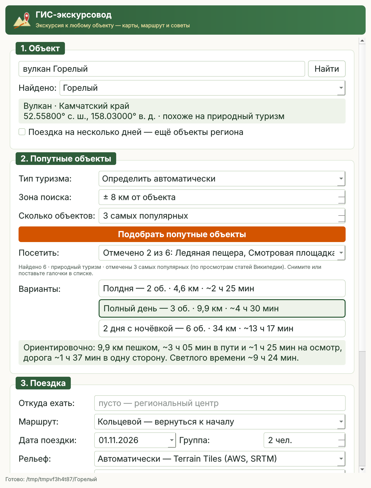
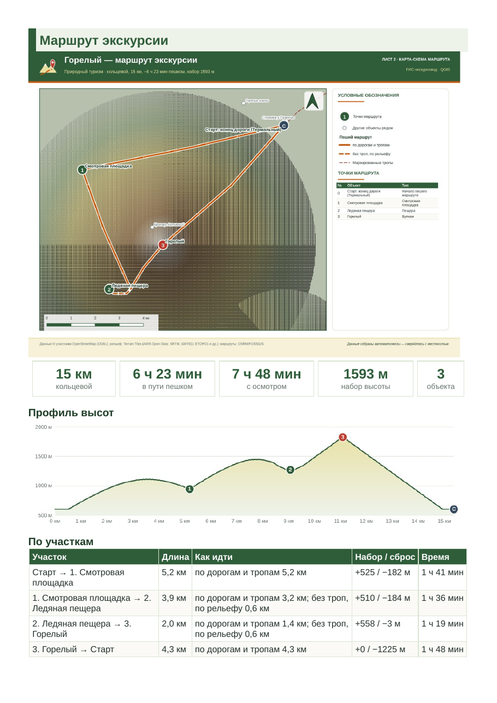

<p align="center">
  
</p>

<h1 align="center">ГИС-экскурсовод</h1>

<p align="center">
  <b>Плагин QGIS: название объекта на входе — готовая экскурсия на выходе.</b><br>
  Попутные объекты, маршрут по тропам и рельефу, три фирменные карты,<br>
  отчёт HTML и PDF, трек для навигатора и офлайн-пакет для телефона
</p>

<p align="center">
  <a href="https://github.com/dzhavrshyan-geo/GIS-Tour-Guide/actions/workflows/tests.yml"></a>
  
  
  
</p>

<p align="center">
  <b><a href="release/gis_tour_guide-0.4.0.zip">Скачать плагин</a></b> ·
  <a href="docs/ИНСТРУКЦИЯ.md">Инструкция</a> ·
  <a href="docs/ИНСТРУКЦИЯ.pdf">Инструкция (PDF)</a> ·
  <a href="docs/presentation/ГИС-экскурсовод_0.4.pdf">Презентация (PDF)</a> ·
  <a href="docs/example/report.pdf">Пример отчёта</a> ·
  <a href="CHANGELOG.md">Что нового</a>
</p>

---

<table>
  <tr>
    <td width="45%"></td>
    <td width="55%"></td>
  </tr>
  <tr>
    <td><sub>Окно: объект, попутные объекты, варианты «полдня / день / 2 дня»</sub></td>
    <td><sub>Отчёт: карта-схема маршрута, итоги, профиль высот, участки</sub></td>
  </tr>
</table>

## Возможности

Пишете название туристического объекта — **«вулкан Горелый»** или **«Московский Кремль»** — и плагин:

| | |
|---|---|
| **Находит объект** | по OpenStreetMap и Википедии; определяет тип туризма — природный или городской |
| **Подбирает попутные объекты** | самые популярные в зоне ±1…30 км (по просмотрам Википедии); варианты «Полдня», «Полный день», «2 дня с ночёвкой» по световому дню |
| **Строит маршрут** | от регионального центра или крупного города; порядок обхода; пешком по маркированным тропам, без троп — по рельефу в обход круч, озёр и рек; в городе — от метро |
| **Планирует** | разбивку по дням и три варианта ночлега; сезон и доступность — часы работы, ООПТ, зимники, перевалы |
| **Рисует карты и отчёт** | три карты-макета QGIS и отчёт HTML (интерактивные карты внутри) и PDF: как добраться, что взять по погоде, где поесть, безопасность, фото, природа |
| **Готовит в дорогу** | трек GPX/KML, офлайн-пакет с собственной картой MBTiles, ссылку на отчёт с QR-кодом |
| **Поездка на несколько дней** | 2–5 объектов региона, переезды, ночлег и общий план по дням |

Все источники открытые (OpenStreetMap, Википедия, OSRM, Open-Meteo, Викисклад, iNaturalist) —
ключи API не нужны. [Пример отчёта](docs/example/report.pdf) собран на тестовых данных
(фотографии — заглушки).

## Установка

1. Скачайте [**gis_tour_guide-0.4.0.zip**](release/gis_tour_guide-0.4.0.zip) (кнопка «Download raw file»).
2. В QGIS: **Модули → Управление и установка модулей → Установить из ZIP** → выберите файл.
3. В меню «Модули» появится «ГИС-экскурсовод» и кнопка на панели инструментов.

Нужен QGIS 3.22 или новее и интернет.

## Документация

- [**Инструкция**](docs/ИНСТРУКЦИЯ.md) — как пользоваться, что получается, как устроено,
  ограничения, лицензии данных; [то же в PDF](docs/ИНСТРУКЦИЯ.pdf).
- [**Презентация**](docs/presentation/ГИС-экскурсовод_0.4.pdf) (PDF).
- [**Пример отчёта**](docs/example/report.pdf) (PDF, тестовые данные).
- [**История изменений**](CHANGELOG.md).

Нашли ошибку или есть идея — [создайте обращение](https://github.com/dzhavrshyan-geo/GIS-Tour-Guide/issues/new/choose).

## Для разработчика

```
gis_tour_guide/
  planner.py   два шага без QGIS: collect() — попутные объекты, plan() — экскурсия; этапы для окна загрузки
  trip.py      поездка на несколько дней: порядок объектов, план по дням, общий GPX/KML
  outputs.py   слои, макеты и отчёты (главный поток) — для экскурсии и для поездки
  hours.py     разбор opening_hours: открыто ли в дату поездки
  trails.py    сеть маркированных троп, путь по ней
  offline.py   офлайн-пакет: своя подложка из OSM → MBTiles → zip
  publish.py   публикация на GitHub Pages, QR-код
  geocode.py   Nominatim + Википедия, граница региона
  osm.py       Overpass: категории для природы и города, население, региональный центр,
               плотность застройки, транспорт, кафе, магазины, ООПТ; выбор точки старта
  wiki.py      Википедия (описания, популярность), Викигид, Викиданные, Викисклад
  routing.py   OSRM: машина, пешеход, сводка по дорогам, участки без троп, маркированные тропы
  terrain.py   тайлы высот (параллельная загрузка), профиль, Тоблер, путь по рельефу (A*) с маской воды
  tsp.py       порядок обхода
  extras.py    погода, iNaturalist, опасные животные
  advice.py    советы для природы и для города
  report.py    фирменный отчёт HTML/PDF, GPX, профиль высот, фото в памяти
  webmap.py    интерактивные карты HTML (vendor/leaflet — Leaflet 1.9.4, BSD-2)
  schedule.py  оценка времени, разбивка по дням, варианты «полдня / день / 2 дня»
  maps.py      слои, GeoPackage (векторы + растр), фирменные стили, три макета
  brand.py     фирменные цвета и стиль окна
  progress.py  окно загрузки
  widgets.py   выпадающий список с галочками
  dem_layer.py высоты из слоя ЦМР проекта
  task.py      фоновые задачи QgsTask
  dialog.py    окно плагина
```

Тесты (без сети — ответы сервисов подделаны в `tests/fake_services.py`, два сценария:
вулкан Горелый и Московский Кремль):

```
python -m unittest discover -s tests   # test_pipeline.py — нужен Python из QGIS (модуль qgis)
python tools/build_zip.py              # dist/gis_tour_guide.zip
python tools/make_doc_images.py        # скриншот окна и пример отчёта для документации
python tools/build_docs.py             # docs/ИНСТРУКЦИЯ.pdf (нужны markdown, Node.js, Playwright)
node tools/build_presentation.js       # PDF презентации из docs/presentation/source
```

Тесты идут на каждый push в GitHub Actions (Ubuntu 24.04, QGIS 3.34 без окна), без сети:
ответы сервисов подделаны в `tests/fake_services.py`.

## Авторы и лицензия

Джавршян Роберт и Claude (Anthropic).

Свободное программное обеспечение: [GNU General Public License версии 2](LICENSE) или более
поздней. Предоставляется «как есть», без каких-либо гарантий. Leaflet (`vendor/leaflet`) — BSD-2.
Лицензии данных — в [инструкции](docs/ИНСТРУКЦИЯ.md#8-лицензии-данных).
